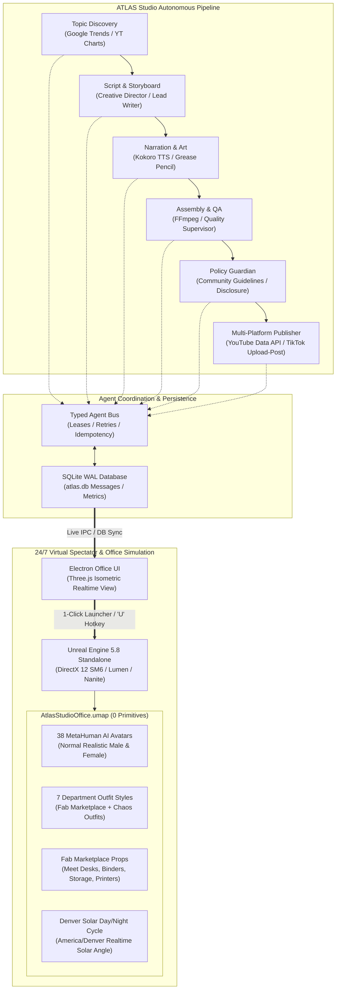
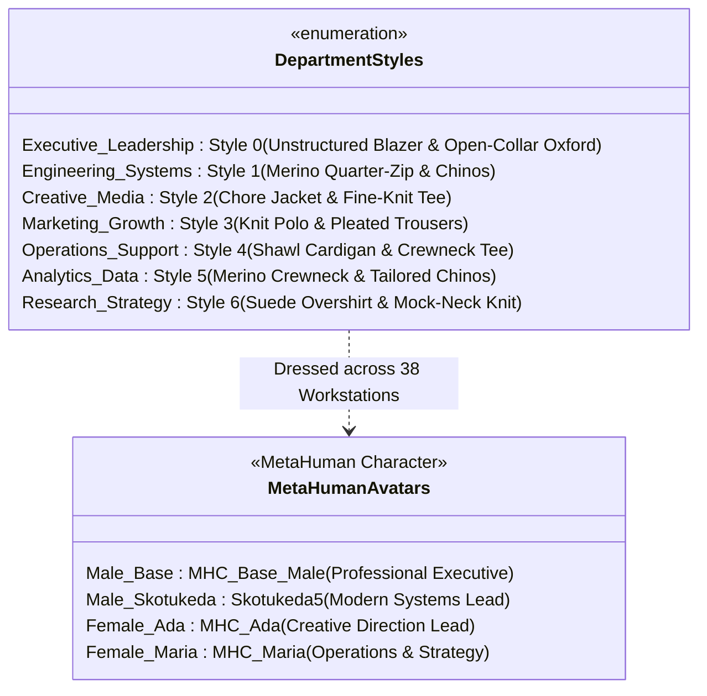

# Clearly Drawn Studios — ATLAS Autonomous Production Engine & 3D MetaHuman Office

> **Studio:** Blender shoots reuse the CDN broadcast studio via `AtlasStudioOffice\studio_manifest.json` and `blender/studio_api.py` (see `docs/BLENDER_STUDIO.md`). The UE office simulation and 38-agent MetaHuman crowd below are **legacy**: don't extend or depend on them.


## Project Status: Milestone 1 Verified Locally; UE 5.8 3D Office Simulation Live

**Last Updated:** 2026-10-16  
**Branch:** master  
**Working Directory:** `C:\Users\chrom\Desktop\Marker\atlas-studio`

---

## Architecture Overview

```
atlas-studio/
├── .opencode/                    # Skill pack (38 skills, 12 workflows, 8 schemas)
│   ├── config/                   # Agent registry (38 roles), defaults, editorial rules
│   ├── skills/                   # 38 agent skills (trend-scout → publisher, tiktok-publisher)
│   ├── workflows/                # 12 orchestrated workflow guides
│   ├── schemas/                  # 8 JSON Schema contracts
│   ├── scripts/                  # Python reference implementations & publishers
│   └── reference/                # Specs, bibles, API reality docs
├── crates/                       # Rust workspace (10 crates)
│   ├── atlas-core/               # Shared types, errors, schemas
│   ├── atlas-doctor/             # Tool discovery (OpenCode, Blender, UE, FFmpeg, ArtCraft, Kokoro)
│   ├── atlas-opencode/           # NVIDIA provider reuse via OpenCode CLI
│   ├── atlas-store/              # SQLite WAL persistence
│   ├── atlas-agent-bus/          # Typed message bus with leases, retries
│   ├── atlas-analytics/          # Retention curves, CTR, multi-platform publishing (YouTube + TikTok)
│   ├── atlas-blender/            # Grease Pencil stroke-reveal render pipeline
│   ├── atlas-kokoro/             # Sentence-segment TTS with retakes
│   ├── atlas-ffmpeg/             # EDL → filter_complex → MP4 + captions
│   └── atlas-cli/                # Unified CLI entrypoint
├── office-ui/                    # Electron + Three.js 24/7 Agent Visualizer & 1-Click UE Launcher
├── docs/                         # System specifications & architecture documentation
│   ├── CHARACTER_SYSTEM.md       # Luma narrator direction & visual grammar
│   ├── POLICY_GUARDIAN.md        # Pre-publish community guidelines & automated strike guard
│   └── OFFICE_SIMULATION.md      # UE 5.8 3D Virtual Spectator & MetaHuman Office specification
├── tools/                        # Bundled binaries (VectorCraft, PhotoCraft, EffectCraft)
├── artifacts/first-run/          # Verified first-run video package
├── Launch_Unreal_3D_Office.bat   # 1-Click Standalone Virtual Spectator Launcher (-game mode)
└── Cargo.toml                    # Workspace root
```

---

## System Architecture & Live Simulation Diagram



Clearly Drawn News has its own flow (research with 2 sources, auto approval, Anthropic script, voices, Unreal filming, auto-holds, YouTube and TikTok publish gates). See [docs/NEWS_PIPELINE.md](docs/NEWS_PIPELINE.md).

---

## 38 AI Agent Workstations & 7 Department Outfit Styles

The Clearly Drawn Studios HQ features 38 dedicated workstations arranged in a 10-column layout, surrounded by the 38-seat Boardroom, Central Operations Hub, Kitchenette / Breakroom, and Brainstorm Bullpen. Every agent is represented by a normal, realistic human MetaHuman avatar (strictly no zombie or generic monster models).



### Dress Code: Elevated Smart Casual

Every MetaHuman dresses between business casual and casual: polished but relaxed. No ties, suits, hoodies, or athleisure. The source of truth is [`unreal/wardrobe.json`](unreal/wardrobe.json), applied in Unreal by [`unreal/Content/Python/clearly_drawn_wardrobe.py`](unreal/Content/Python/clearly_drawn_wardrobe.py).

| Character | Look |
|:----------|:-----|
| **Marcus** (The Enthusiast) | Unstructured navy blazer, open-collar ecru oxford, stone chinos, brown suede loafers |
| **Elena** (The Sharp Counterpart) | Soft charcoal overshirt, cream mock-neck knit, tailored olive trousers, black chelsea boots |

| Staff look | Pieces |
|:-----------|:-------|
| 1 | Merino crewneck, tailored chinos, white leather sneakers |
| 2 | Unstructured blazer, open-collar oxford, trousers, loafers |
| 3 | Chore jacket, fine-knit tee, dark chinos, sneakers |
| 4 | Knit polo, pleated trousers, leather derbies |
| 5 | Merino quarter-zip, khaki chinos, sneakers |
| 6 | Suede overshirt, mock-neck knit, charcoal trousers, chelsea boots |
| 7 | Shawl cardigan, crewneck tee, stone chinos, sneakers |


---

## 100% Primitive-Free Real 3D Environment (Fab Marketplace & Poly Haven CC0)

Automated validation via [`final_verification_report.txt`](file:///c:/Users/chrom/Desktop/Marker/AtlasStudioOffice/final_verification_report.txt) confirms **`Primitive Shape Actors Found: 0`**. All cubes, cylinders, and generic shapes have been completely replaced with real copyright-free downloaded models:

- **Modular Studio Floor**: Real Fab Marketplace [`Base`](file:///c:/Users/chrom/Desktop/Marker/AtlasStudioOffice/Content/Assets/Props/FabOfficeWork/Base.uasset) architectural floor mesh tiled seamlessly across the entire floor (`-81.0` Z offset).
- **38-Seat Boardroom**: Dual Fab Marketplace [`meet_Desk`](file:///c:/Users/chrom/Desktop/Marker/AtlasStudioOffice/Content/Assets/Props/FabOfficeWork/meet_Desk.uasset) conference tables surrounded by 38 conference armchairs and a presentation [`projector_screen`](file:///c:/Users/chrom/Desktop/Marker/AtlasStudioOffice/Content/Assets/Props/ProjectorScreen/projector_screen_1k/StaticMeshes/projector_screen.uasset).
- **Kitchenette & Breakroom**: Poly Haven CC0 [`CoffeeCart_01_cart`](file:///c:/Users/chrom/Desktop/Marker/AtlasStudioOffice/Content/Assets/Props/CoffeeCart/CoffeeCart_01_1k/StaticMeshes/CoffeeCart_01_cart.uasset) equipped with real espresso mugs (`CoffeeCart_01_mugs`) and pitcher (`CoffeeCart_01_props`), authentic [`Shell_Material_013_0`](file:///c:/Users/chrom/Desktop/Marker/AtlasStudioOffice/Content/Assets/Props/VendingMachine/scene/StaticMeshes/Shell_Material_013_0.uasset) vending machine, and dual [`Sofa_01_1k`](file:///c:/Users/chrom/Desktop/Marker/AtlasStudioOffice/Content/Assets/Props/Sofa/Sofa_01_1k/StaticMeshes/Sofa_01_1k.uasset) lounge sofas.
- **Environmental Storytelling Props (Fab Marketplace)**:
  - Filing storage cabinets: [`FileStroge`](file:///c:/Users/chrom/Desktop/Marker/AtlasStudioOffice/Content/Assets/Props/FabOfficeWork/FileStroge.uasset) stationed across aisles.
  - Central office printers: [`printer`](file:///c:/Users/chrom/Desktop/Marker/AtlasStudioOffice/Content/Assets/Props/FabOfficeWork/printer.uasset) in the printing hub.
  - Brainstorming whiteboard: [`whiteboard`](file:///c:/Users/chrom/Desktop/Marker/AtlasStudioOffice/Content/Assets/Props/FabOfficeWork/whiteboard.uasset) in the engineering bullpen.
  - Supply & moving boxes: [`SM_Prop_CardboardBox_01`](file:///c:/Users/chrom/Desktop/Marker/AtlasStudioOffice/Content/Assets/Props/FabOfficeWork/SM_Prop_CardboardBox_01.uasset) clustered in storage areas.
  - Office binders & document clutter: [`SM_Binder_Standard`](file:///c:/Users/chrom/Desktop/Marker/AtlasStudioOffice/Content/Assets/Props/FabBinder/SM_Binder_Standard.uasset) and [`SM_Binder_4_Stack`](file:///c:/Users/chrom/Desktop/Marker/AtlasStudioOffice/Content/Assets/Props/FabBinder/SM_Binder_4_Stack.uasset) distributed across desks.
  - Workstation clutter: Poly Haven CC0 laptops, articulated lamps, stationery pencil cups, and botanical plants. Zero Sketchfab assets.

---

## Virtual Spectator View Window (Launch Configuration)

To launch the Unreal Engine 5.8 3D simulation without opening the editor:
- **Executable Shortcut**: [`Launch_Unreal_3D_Office.bat`](file:///c:/Users/chrom/Desktop/Marker/Launch_Unreal_3D_Office.bat)
- **Electron UI Button**: Click **"⚡ Virtual Spectator (UE 5.8)"** or press the **`U`** key in the desktop app.
- **Launch Command**:
  ```cmd
  "C:\Program Files\Epic Games\UE_5.8\Engine\Binaries\Win64\UnrealEditor.exe" "C:\Users\chrom\Desktop\Marker\AtlasStudioOffice\AtlasStudioOffice.uproject" -game -windowed -ResX=1920 -ResY=1080 -WinX=60 -WinY=30 -messaging
  ```
  *(The `-game` switch placed immediately after `.uproject` guarantees that the standalone spectator game window opens directly without launching the editor GUI).*

---

## Rust Workspace Status

| Crate | Purpose | Key Features |
|-------|---------|--------------|
| `atlas-core` | Shared types | Project states, agent messages, tool kinds, render presets, `PublishPlatform` |
| `atlas-doctor` | Tool discovery | Probes OpenCode, Blender 5.1, UE 5.8, FFmpeg, Kokoro, VectorCraft/PhotoCraft/EffectCraft |
| `atlas-opencode` | NVIDIA provider reuse | Parses `opencode providers list`, `opencode models nvidia` via supported CLI |
| `atlas-store` | SQLite WAL | Projects, artifacts, agent messages, YouTube metrics, retention curves |
| `atlas-agent-bus` | Message bus | Leases, heartbeats, exponential backoff retries, idempotency keys |
| `atlas-analytics` | Multi-Platform Analytics & Publishing | YouTube Data API, TikTok Upload-Post API, cliff detection, optimization loops |
| `atlas-blender` | Render pipeline | Grease Pencil stroke-reveal script gen, preview/final quality, frame collection |
| `atlas-kokoro` | TTS synthesis | Sentence-segment with retakes, word timestamps, FFmpeg concat, pronunciation hints |
| `atlas-ffmpeg` | EDL assembly | Filter complex builder, concat + amix, caption tracks, SRT/VTT output |
| `atlas-cli` | Unified CLI | `doctor`, `produce`, `publish`, `tiktok`, `analytics`, `topics` |

---

## Running Verification Commands

```bash
# 1. Run all workspace tests
cargo test

# 2. Check tool discovery & system health
.\target\release\atlas.exe doctor

# 3. Verify final Unreal Engine 5.8 office map
& "C:\Program Files\Epic Games\UE_5.8\Engine\Binaries\Win64\UnrealEditor-Cmd.exe" "C:\Users\chrom\Desktop\Marker\AtlasStudioOffice\AtlasStudioOffice.uproject" -run=pythonscript -script="C:\Users\chrom\Desktop\Marker\AtlasStudioOffice\Content\Python\verify_final_map.py" -stdout -unattended -nosplash
```
