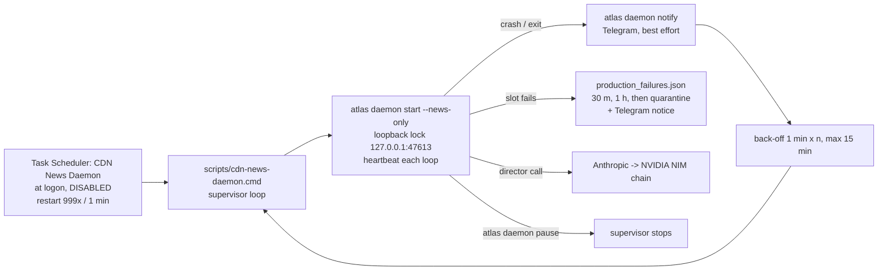

# HANDOFF: Clearly Drawn Studios / Clearly Drawn News

Updated Sun Oct 18, 2026, 6:20 PM MDT. Master index: `Marker\START_HERE_CDN.md` (tracked mirror `START_HERE_CDN.md`). Canonical copy: `atlas-studio/HANDOFF.md` (tracked in git). `Marker\HANDOFF.md` is a mirror
copy for agents that open `Marker\` first. Update both when you change it.

This file lets Claude Code (or any agent) continue the work on Eli's own Claude credits with no other context. Read it with
`CLAUDE.md` (repo), `AtlasStudioOffice\CLAUDE.md` (studio), `docs/NEWS_PIPELINE.md` (news pipeline) and
`AtlasStudioOffice\casting\voices\VOICE_HANDOFF.md` (anchor voices) and `blender/STUDIO_HANDOFF.md` (studio queue; mirror `AtlasStudioOffice\STUDIO_HANDOFF.md`).

## 1. Eli's rules (non-negotiable)

1. **Publishing stays OFF until Eli says "go".**
   - `ATLAS_NEWS_PUBLISH` stays unset or `off`, and `ATLAS_NEWS_TIKTOK` stays unset or `off`.
   - Task Scheduler task `CDN News Daemon` stays **Disabled**.
   - Never upload a real video while testing. Use `--dry-run-publish`.
2. **One question at a time.** When you need Eli, ask a single, specific question and wait. Never send a list of questions.
3. **Never say "yep"**, and don't use filler acknowledgements. Be brief and concrete.
4. **No primitives.** Every studio prop, texture and HDRI is a downloaded asset.
5. **Asset licenses:**
   - Use CC0 or AI-OK assets. CC BY 4.0 is fine with attribution: the credits go in every description (see TODO A1).
   - Fab Glowbox3D lights carry a NoAI note: use them for rendering only, never as dataset or genAI inputs.
6. **Real MetaHumans only.**
   - Never call a rig a MetaHuman without its Unreal asset path.
   - `Armature_Elena`, `Armature_Marcus` and `Armature_Chef` are placeholders until the real MetaHuman exports arrive.
   - No Renderpeople, and no mannequins as anchors.
7. **Never print or log secrets.** That covers keys, tokens and `youtube_credentials.json` contents. Use `atlas config show --redact`.
8. **No X (Twitter) in any form.** No API, no token request, no scraping. Eli is banned. Don't scrape logged-in Instagram, TikTok or Threads either.
9. **Don't touch a live Blender session.** PID 32104 was the studio session on Oct 18.
   - Headless jobs open a copy (`open_studio(copy_to=...)`).
   - Never edit or re-save the original `.blend` files.
10. **Facts:**
    - Two independent sources per story (fixed), or a verified official account of the attributed studio announcing its own project.
    - Every credit names the outlet and region.
    - Cooking and Debate Corner run straight, with no story or bible beats.
11. **Thursday Throwback:**
    - Guests are public-domain originals only and appear only on the `guest_feed` monitor.
    - Every guest speaks with an original designed voice. No cloning of real people or of voice actors' performances.
    - Five questions, the horror-movie closer and the on-screen disclaimer stay.
12. **Leave `news/EP-006` alone.** It is Eli's test episode. The next episode is EP-007.
13. Small, clear commits. Keep `CLAUDE.md`, the docs and the Mermaid diagrams current in the same change.
14. **Don't commit other agents' work in progress.**
    - On Oct 18 this was `crates/atlas-kokoro/src/lib.rs` (the Kokoro `PYTHONUSERBASE` fix, owned by the voice agent).
    - `vlc-help.txt` is a stray file and shouldn't be committed either.

## 2. Where things are

| What | Where |
|------|-------|
| Rust workspace | `C:\Users\chrom\Desktop\Marker\atlas-studio` (branch `feature/blender-studio-manifest`) |
| Run directory (credentials resolve here) | `C:\Users\chrom\Desktop\Marker` |
| News data / episodes | `%LOCALAPPDATA%\atlas-studio\atlas\data\news\EP-###` |
| Daemon state and logs | `%LOCALAPPDATA%\atlas-studio\atlas\data\daemon\` (`daemon.log`, `daemon.log.1`, `heartbeat`, `news_last_run`, `production_failures.json`, `paused`) |
| Studio (Blender + Unreal) | `C:\Users\chrom\Desktop\Marker\AtlasStudioOffice` (`studio_manifest.json` is the source of truth) |
| Season plan | `AtlasStudioOffice\casting\series\` (`CDN_Season1_Bible.md`, `CDN_Season1_beats.csv/.json`, `src\_calendar.md`, `CDN_Chef_Character.md`) |
| Voices | `AtlasStudioOffice\casting\voices\` (`VOICE_HANDOFF.md`, `VOICE_BIBLE_INDEX.md`) |
| CC BY credits | `AtlasStudioOffice\assets\fab_cc_by\CREDITS_CC_BY.md`. The studio worker is adding `asset_credits` to `studio_manifest.json` |

Keys come from User environment variables only, never from files in the repo:
- `ANTHROPIC_API_KEY` (or `ATLAS_DIRECTOR_API_KEY`)
- `NVIDIA_API_KEY`
- `TELEGRAM_BOT_TOKEN` and `TELEGRAM_CHAT_ID` (not set yet)
- the TikTok client keys

The YouTube OAuth files `youtube_credentials.json` and `youtube_token.json` sit in `Marker\`.

## 3. State of each workstream (Oct 18, 2026)

### News pipeline (atlas-cli / atlas-media / atlas-storyboard): working end to end with Unreal faked
- **Live wire:**
  - About 30 RSS/Atom feeds by region: US, Japan, UK/Europe, Korea, China and Canada. There is no Latin American feed.
  - Newsrooms: MAPPA and Ghibli.
  - Official accounts:
    - 17 YouTube channel RSS feeds plus 2 Bluesky accounts (Netflix and Crunchyroll), pinned in `crates/atlas-media/data/official_accounts.json`.
    - These are keyless, and none are on X.
  - The director translates non-English entries; the original headline and URL are kept.
- **Fact check:** fixed two-source rule with an official-primary exception (`fact_checker::qualifies_as_official_primary`), rumor flags, and a 7-day aired-story dedupe.
- **Director chain:**
  - Anthropic `claude-sonnet-5-5` first.
  - NVIDIA NIM failover after that: `nvidia/nemotron-3-ultra-550b-a55b`, then `z-ai/glm-5.3-flash`, then `openai/gpt-oss-20b`.
  - Billing, quota and key errors drop a provider for the whole run; 5xx errors and timeouts fail over for that call only.
  - Every call is logged (stderr plus `ATLAS_DIRECTOR_LOG`). `atlas news director-check` shows the chain.
- **Episode policy:** one 30-minute episode a day at 12:00 MDT (`ATLAS_NEWS_HOURS=12`, `ATLAS_NEWS_TARGET_MINUTES=30`, ±5).
  - Retrospectives (fact-checked) fill short news days, up to 8.
- **Voices:** Kokoro (`am_michael` / `af_bella`) by default, or Voicebox with `ATLAS_TTS_ENGINE=voicebox`. Kokoro output goes to loudnorm at -16 LUFS.
- **Output:** animatic preview, lipsync.json, the YouTube package (metadata, SRT, thumbnail) and a single TikTok vertical cut.
- **Auto-holds:** curated wire, a runtime outside policy, filming skipped, rights not clear, or a guest trademark caveat.
- **Known weak spot:** studio attribution sometimes names an outlet or streamer ("Max", "The New York Times") as the studio. This is TODO P1.

### Studio (Blender v3 polished; Unreal project for Phase 6)
- These are done:
  - the desk and the weekend_update camera plan
  - the Thursday Throwback walk and the interview corner
  - the BTS shell and props, craft services and wall decor
  - the wardrobe rotation hook
  - the kitchen set `16_KITCHEN_SET`: 5 kitchen cameras, chef and anchor stand markers, and a reference screen `REF_IMAGE`
- 15 Fab CC BY 4.0 props are used in the set (credits file above).
- Gaps:
  - `KITCHEN_FRIDGE_SLOT` and `KITCHEN_MIXER_SLOT` are empty. No CC0 asset was found for either.
  - The MetaHumans for Elena, Marcus and Chef Quill aren't built yet. `verify_studio` shows 3 pending.
- `atlas news produce` Phase 6 films in **Unreal**. Choosing the Blender studio as the Phase 6 engine is not wired yet.

### Voices (owned by the voice agent; see `VOICE_HANDOFF.md`)
- Eli rejected the stock Kokoro anchor voices.
- v2 original voices were designed with Parler-TTS. References are `elena_v2_reference.wav` and `marcus_v2_reference.wav`.
  - Voicebox profiles `CDN Elena v2` and `CDN Marcus v2` exist.
  - The pipeline env vars `ATLAS_VOICEBOX_ELENA` and `ATLAS_VOICEBOX_MARCUS` still point at the old profiles.
- In progress: Chatterbox Turbo expressive takes, the `banter_audit_v2.wav` mix, then opening it in VLC for Eli.
- Thursday Throwback guests:
  - Gertie (Oct 22) and Felix (Oct 29) speak with neural, designed voices. Their scripts are 14:10 and 17:45.
  - Steamboat Willie (Nov 5) and Popeye (Nov 12) have test lines. **Steamboat Willie has a voice-rights flag for Eli.**
- Chef Delphine Quill: line prefix `CQ-LINE-nnn`, seeds 700+, folder `voices\chef_quill`.

### Story / season (`casting\series`)
- Season 1 runs Mon Oct 19, 2026 to Thu Jan 7, 2027: one episode a day.
- Segments:
  - news desk every day
  - Thursday Throwback (weekly)
  - Debate Corner
  - Cooking, live from the week of Nov 2. The kitchen set rolls in Sat Oct 31.
- The bible beats are in `CDN_Season1_beats.csv/.json` (v3). Cooking and debate carry no beats.
- Felix script: **OTS re-aim needed** (see the script).

## 3b. Done vs half-done in this pipeline session (exact places)

**Done and committed:**
- International wire: `crates/atlas-media/src/news_wire.rs` (`FEEDS`, `group_story`).
- Official accounts: `news_social.rs`.
- Two-source rule: `fact_checker::qualifies_as_official_primary`.
- Translation: `crates/atlas-cli/src/news_translate.rs`.
- Director chain: `crates/atlas-storyboard/src/lib.rs` (`DirectorClient::chain`, `classify`).
- 30-minute single daily slot and retros: `news_retro.rs`, `story_script::retros_needed_with_feature`.
- Daemon self-heal:
  - `daemon.rs`: `acquire_daemon_lock`, `write_heartbeat`, Telegram on slot failure, `DaemonAction::Notify`.
  - `scripts/cdn-news-daemon.cmd` and `scripts/register-cdn-daemon.ps1`.
  - The task has been re-registered; it is **Disabled**, restart 999x every 1 minute.

- A1 asset credits: `crates/atlas-cli/src/news_credits.rs`, `news_publish::build_metadata(.., credits)`, `news_tiktok::caption_with_credits`. Done, with tests.

**Not started yet (no code):**
- P1: matching. Start in `news_wire.rs` at `AMBIGUOUS_ORGANIZATIONS`, `organization()`, `pattern_organization()` and `attribute_organization()`; add an outlet/streamer exclusion list built from `FEEDS` outlet names.
- P2–P5.

**Research already done for P3 (recipes):**
- Binging with Babish (`https://www.babi.sh`) exposes schema.org `Recipe` JSON-LD (`recipeIngredient`, `recipeInstructions`, author). `robots.txt` has no `*` disallow. The sitemap `https://www.babi.sh/sitemap.xml` lists 636 pages.
- Animation dishes found:
  - `/recipes/herring-and-pumpkin-pot-pie-inspired-by-kiki's-delivery-service`
  - `/recipes/remys-soup-ratatouille`, `/recipes/ratatouille`
  - `/recipes/giant-red-bean-bun-inspired-by-spirited-away`
  - `/recipes/japanese-style-big-mac-inspired-by-weathering-with-you`
  - `/recipes/avatar-fire-flakes`
  - `/recipes/together-breakfast-steven-universe`
  - `/recipes/cookie-cat-steven-universe`
  - `/recipes/adventure-time-sandwich`
  - `/recipes/arepas-con-queso-encanto`
  - `/recipes/trenette-el-pesto-luca`
  - `/recipes/tamalesfromcoco`
  - `/recipes/mulancongee`
  - `/recipes/ichiraku-ramen-inspired-by-naruto`
  - `/recipes/bell-peppers-and-beef-inspired-by-cowboy-bebop`
  - `/recipes/mitarashi-dango-inspired-by-demon-slayer`
  - `/recipes/chicken-meatball-hotpot-inspired-by-jujutsu-kaisen`
  - `/recipes/souffle-pancakes-inspired-by-food-wars!`
  - `/recipes/chocolate-pudding-rugrats`
  - `/recipes/bobbys-cookies-king-of-the-hill`
  - `/recipes/footlong-taco-dogs-bobs-burgers`
  - `/recipes/pretty-patties-spongebob`
  - `/recipes/mayors-request-cloudy-with-a-chance-of-meatballs`
- Store only the ingredient lists (facts) plus the credit ("Recipe: Binging with Babish, babi.sh/...") and "Seen in: title (year)". Write the on-air steps in our own words; don't copy the prose instructions.
- Kitchen prop inventory for `atlas news props` is in `blender/studio_optimization_report.md` (Kitchen set section). The fridge and mixer slots are empty.
- Chef rules: `AtlasStudioOffice\casting\series\CDN_Chef_Character.md`.
- Chef speaker: add `AnchorRole::Chef` in `crates/atlas-storyboard/src/two_anchor_script.rs`. About 62 match sites; the compiler lists them. Voice `ATLAS_CHEF_VOICE`. Line IDs `CQ-LINE-nnn`.
- Cameras: `kitchen_wide`, `kitchen_three_shot`, `kitchen_single_chef`, `kitchen_overhead`, `kitchen_hero_plate`. Stand markers: `STAND_MARKER_Chef` / `_Kitchen_Elena` / `_Kitchen_Marcus`.
- TikTok single clip today: `crates/atlas-cli/src/news_tiktok.rs` `highlight_window`. Generalise it to N windows for P4.

## 4. Prioritized TODO (with acceptance criteria)

Work top-down. Commit after each item (`feat(...)`, `docs(...)`), with the docs, CLAUDE.md and Mermaid updated in the same commit.

| # | Item | Done when |
|---|------|-----------|
| A1 | **CC BY asset credits** in `news_publish` | Every YouTube description ends with an `Asset credits` block (title, creator, URL, "CC BY 4.0"), read from `studio_manifest.json` `asset_credits` and falling back to `CREDITS_CC_BY.md`. The TikTok caption gets it if it fits, otherwise `publish/tiktok_pinned_comment.txt`. Unit test; documented in `NEWS_PIPELINE.md` |
| P1 | **Studio-name matching** | Outlets, newspapers and streamers ("Max", "The New York Times", "Disney+", "Netflix" used as a platform in "on Netflix", feed outlet names, festival names) are never returned as the studio. Tests cover each case; `cargo test -p atlas-media` passes |
| P2 | **Debate Corner + Cooking segments** and the weekly rotation | `atlas news produce` adds one feature segment per day from a configurable weekday rotation (default: Thu = Throwback, Mon/Wed/Fri = Cooking from Nov 2, Tue/Sat = Debate Corner, Sun = news plus retros). Debate: both anchors take opposite fan views, facts are verified and opinions are labelled. Cooking: Chef Quill (new speaker with her own voice) plus Elena and Marcus, with the rules from `CDN_Chef_Character.md`. Tests for the rotation and segment validity |
| P3 | **Credited recipe catalog + food-safety gate + `atlas news props` + `atlas news cook-anim`** | Recipes come with credits (source URL and author; ingredients only; steps written in our own words; "Seen in: title (year)"). The gate checks USDA minimum internal temperatures, raw egg, top-9 allergen callouts, knife/mandoline/hot-oil safety and date labels, and holds the segment on failure. `props` maps ingredients and tools to set props (the kitchen inventory in `blender/studio_optimization_report.md`) and flags NEW BUILD items. `cook-anim` writes a per-line action plan (stand marker, hands, prop, camera from kitchen_*). Both are wired into produce, with tests |
| P4 | **Several TikTok highlight clips per episode** (still off) | `publish/tiktok/clip_01..N.mp4` plus metadata (default 3, `ATLAS_TIKTOK_CLIPS`). Each clip uses whole lines, is 30–90 s, and has no overlap. Test on window selection |
| P5 | **Full 30-min dry run** | `atlas news produce --skip-telegram-wait --dry-run-publish` with `ATLAS_UE_CMD` pointing at a non-existent editor, producing EP-007 with no upload. Report the runtime (25–35 min) and the segment list |
| S1 | Anchor voices v2 into the pipeline | After Eli approves `banter_audit_v2.wav`: set `ATLAS_TTS_ENGINE=voicebox`, `ATLAS_VOICEBOX_ELENA=CDN Elena v2`, `ATLAS_VOICEBOX_MARCUS=CDN Marcus v2`; an EP dry run uses them |
| S2 | Real MetaHumans for Elena, Marcus and Chef Quill | Unreal asset paths are recorded in `studio_manifest.json`; `verify_studio` shows 0 pending |
| S3 | Blender as the Phase 6 engine (optional) | `ATLAS_FILM_ENGINE=blender` renders via `studio_api.plan_episode` on a copy |
| S4 | Felix OTS re-aim; Steamboat Willie voice-rights answer from Eli | Ask Eli the one question about Willie when it is next relevant |
| S5 | Fridge and mixer props | A CC0 or AI-OK (or credited CC BY) asset is placed, with no primitives |

## 5. How to build, test and dry-run

PowerShell, from `atlas-studio`. The PC is memory-tight, so use `-j 2`.

```powershell
$env:CARGO_INCREMENTAL=0
cargo build --release -j 2 -p atlas-cli          # target\release\atlas.exe
cargo test -j 2 -p atlas-media -p atlas-storyboard -p atlas-cli
.\target\release\atlas.exe doctor
.\target\release\atlas.exe news director-check     # provider chain + which keys exist (never prints them)
.\target\release\atlas.exe news accounts-check     # read-only official account verification
.\target\release\atlas.exe news research           # live wire, regions, corroboration
.\target\release\atlas.exe news health             # feed reliability
```

Full dry run. Run it from `Marker\`. It does no upload and doesn't need Unreal:

```powershell
cd C:\Users\chrom\Desktop\Marker
$env:ATLAS_NEWS_PUBLISH='off'; $env:ATLAS_NEWS_TIKTOK='off'
$env:ATLAS_UE_CMD='C:\atlas-dry-run\no-unreal\UnrealEditor-Cmd.exe'   # missing on purpose -> filming skipped, publish held
.\atlas-studio\target\release\atlas.exe news produce --skip-telegram-wait --dry-run-publish
```

Check `news\EP-###\status.json`, `script.json`, `preview\animatic.mp4` and `publish\youtube_metadata.json`. Delete test episodes you create (never EP-006).
If you air a test, remove its stories from `news\aired_stories.json`. Write that file without a BOM.

Daemon test, one pass in the foreground: `atlas daemon start --news-only --once`.

## 6. Daemon self-healing (in place, task disabled)



- **Restart on failure.**
  - The launcher restarts `atlas.exe` after any exit.
  - If the launcher dies, Task Scheduler restarts it every minute, up to 999 times.
  - A second copy exits with code 3 because of the loopback lock, and the launcher then stops.
- **Survives reboots.** The trigger is at logon. For unattended reboots, turn on Windows auto-logon for `chrom`.
  - `StartWhenAvailable` runs a missed start.
  - There is no time limit, and switching to battery doesn't stop it.
- **Logs:**
  - `daemon\daemon.log` rotates to `daemon.log.1` at 20 MB.
  - `daemon\heartbeat` is updated each loop (default poll 300 s), so a stale heartbeat (older than about 10 minutes) means the daemon is down.
- **Alerts:** Telegram notices go out on start, holds, publish, slot failures and crashes. They need `TELEGRAM_BOT_TOKEN` and `TELEGRAM_CHAT_ID`; without them the notices are skipped silently and never fail anything.
- **LLM fallback:** Anthropic first, then NVIDIA NIM (section 3). With no keys at all, template scripts run, and the runtime hold stops the upload.
- **Re-register or update the task.** It stays disabled:
  `powershell -ExecutionPolicy Bypass -File atlas-studio\scripts\register-cdn-daemon.ps1`
- Pause: `atlas daemon pause`. To resume, start it again.

## 7. Go-live steps (only after Eli says "go")

1. Run `cargo build --release -j 2 -p atlas-cli`, then `cargo test`. Both must be green.
2. Run `atlas news youtube-check` and `atlas news director-check`. Optionally run `tiktok-check`.
3. Do one full dry run (section 5) and have Eli approve the animatic and the YouTube metadata. Check that the runtime is 25–35 minutes, there are no holds, and the asset credits are present.
4. Set User environment variables:
   - Required: `ATLAS_NEWS_PUBLISH=on`.
   - Optional: `ATLAS_NEWS_PRIVACY=public`, `ATLAS_NEWS_TIKTOK=on` (needs TikTok auth and an audited app, otherwise `SELF_ONLY`), and `TELEGRAM_BOT_TOKEN` / `TELEGRAM_CHAT_ID` for alerts.
5. Run `powershell -ExecutionPolicy Bypass -File atlas-studio\scripts\register-cdn-daemon.ps1 -Enable`, then `Start-ScheduledTask 'CDN News Daemon'`.
6. Watch `daemon.log` through the first 12:00 MDT slot. The first episode should be checked by a human on YouTube.
7. To roll back: `atlas daemon pause`, then `Disable-ScheduledTask 'CDN News Daemon'`, then set `ATLAS_NEWS_PUBLISH=off`.
