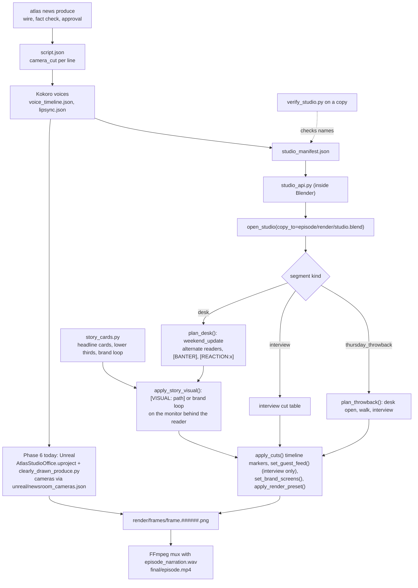
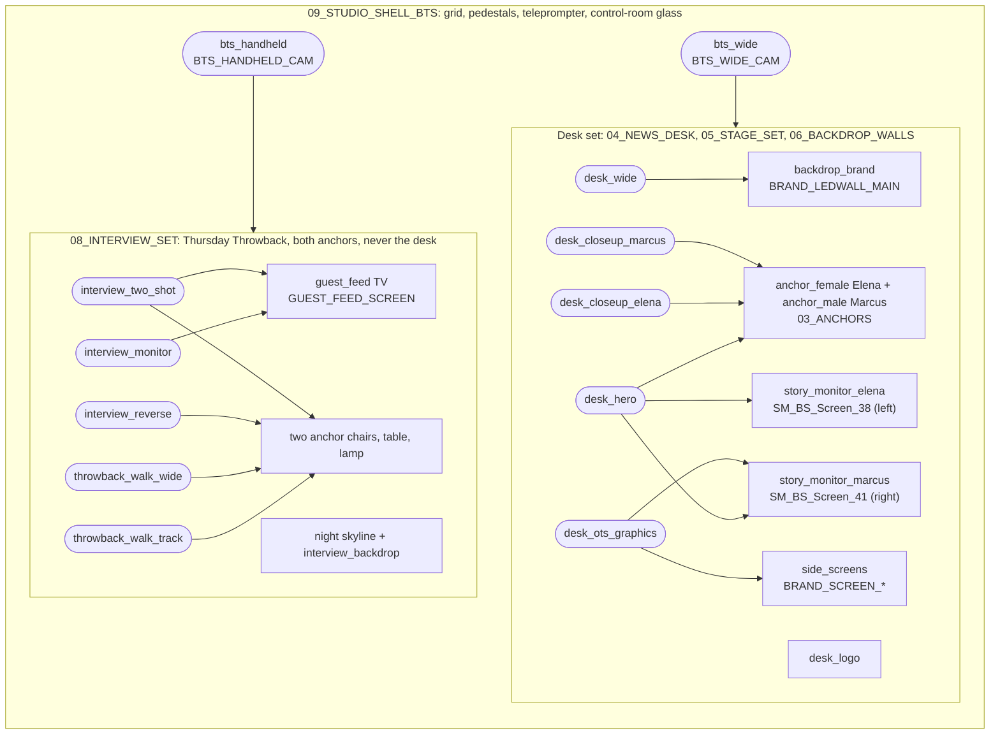

# Blender broadcast studio (CDN)

Shoots in the Blender CDN broadcast studio go through two files in this repo and one manifest next to the set:

| File | Purpose |
|------|---------|
| `C:\Users\chrom\Desktop\Marker\AtlasStudioOffice\studio_manifest.json` | Single source of truth (canonical .blend, camera roles, screen slots, anchor roles, brand kit, render presets, rules). Override with `ATLAS_STUDIO_MANIFEST` |
| `blender/studio_api.py` | Helpers for Blender scripts: `open_studio(copy_to=)`, `camera`/`use_camera(role)`, `camera_for_cut(cut, kind)`, `anchor(role)`, `set_guest_feed(path)`, `set_screen_media(role, path)`, `set_brand_screens()`, `setup_shot(kind)`, `plan_episode(episode_dir, kind)`, `apply_render_preset(name)`, `set_output(dir)`, `validate()` |
| `blender/story_cards.py` | Brand-kit headline cards, lower thirds, and the CDN brand loop (system Python + Pillow, FFmpeg) |
| `blender/verify_studio.py` | Dry-run test. `python blender/verify_studio.py` runs static checks; `blender -b <copy>.blend --python blender/verify_studio.py -- --report out.json` checks every name in the scene. Missing scene names are `PENDING`, broken data is `FAILED` |

Full usage guide: `AtlasStudioOffice\PIPELINE_STUDIO_README.md`.

## Rules

- Desk news defaults to the `weekend_update` camera style (`plan_desk`): wide for open/close only, OTS graphics on
  setups, the reader's locked-off single, `desk_hero` for banter/handoffs, reaction cutaways on `[REACTION:x]`.
  Anchors alternate stories; tags `[BANTER]`, `[SETUP]`, `[REACTION:elena|marcus]`, `[VISUAL: path]`, `[WALK]` are removed
  before Kokoro by `strip_stage_tags` in `crates/atlas-cli/src/news_voice.rs` (any `[bracket]` tag; tag-only lines are
  skipped); `studio_api.strip_tags` is the Python equivalent. Preview captions (`news_preview.rs`) still need it.
- Desk logo slot: material `CDN_DESK_EMBLEM` (pending rename; legacy `Unreal_Medallion_Mat` used meanwhile).
- Story visuals: `set_story_visual("elena"|"marcus", path)` on `SM_BS_Screen_38` (Elena, left) / `SM_BS_Screen_41`
  (Marcus, right); brand loop fallback; guest feeds are refused on desk screens.
- Thursday Throwback: `plan_throwback` (desk open, `throwback_walk_wide` / `throwback_walk_track`, interview cameras).
- Camera roles: `desk_hero`, `desk_wide`, `desk_closeup_elena`, `desk_closeup_marcus`, `desk_ots_graphics`,
  `interview_two_shot`, `interview_reverse`, `interview_monitor`, `bts_wide`, `bts_handheld`, `throwback_walk_wide`,
  `throwback_walk_track`.
- `script.json` `camera_cut` values (`StudioCameraCut`, snake_case) map to roles through `script_cut_map.desk` or
  `script_cut_map.interview`.
- Interviews (Thursday Throwback, weekly, 30 min max) use both anchors in the interview corner and only interview
  cameras; `setup_shot` rejects desk cameras for interviews.
- Guests (public-domain cartoons) appear only on the `guest_feed` monitor, never in the studio.
- Anchors are addressed by role: `anchor_female` (Elena), `anchor_male` (Marcus). Today they are Renderpeople models
  (Claudia, Eric); MetaHuman exports will replace them without changing the roles.
- No primitives: downloaded assets only. Originals are never edited; headless jobs open a copy of the canonical .blend.
- The office simulation (`docs/OFFICE_SIMULATION.md`) is legacy and is not part of this pipeline.

## Relation to `atlas news produce`

Phase 6 still films in Unreal (`DEFAULT_UE_PROJECT` in `crates/atlas-cli/src/news.rs`, cameras from
`unreal/newsroom_cameras.json`). The Blender studio produces frames in the same `render/frames/frame.NNNNNN.png`
layout and can reuse the same episode package through `plan_episode`. Selecting Blender as the Phase 6 engine is
not wired yet.

## Pipeline flow

## Studio layout and camera map

