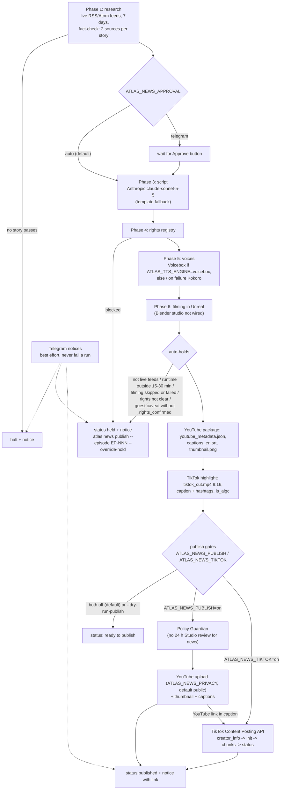

# Clearly Drawn News pipeline

`atlas news produce` builds one episode end to end. `atlas daemon start --news-only` runs it at each
`ATLAS_NEWS_HOURS` slot (default `12,20`, PC local time). Nothing uploads unless `ATLAS_NEWS_PUBLISH=on` (YouTube) or `ATLAS_NEWS_TIKTOK=on` (TikTok); both are off by default.



## Settings

| Setting | Default | Meaning |
| --- | --- | --- |
| `ATLAS_NEWS_PUBLISH` | `off` | `on` uploads; anything else stops at the package (dry run) |
| `ATLAS_NEWS_PRIVACY` | `public` | `public`, `unlisted` or `private` |
| `ATLAS_NEWS_APPROVAL` | `auto` | `telegram` waits for the Approve button |
| `ATLAS_NEWS_MIN_SOURCES` | `2` | sources per story (1 to 3); lower only for testing |
| `ATLAS_NEWS_HOURS` | `12,20` | daemon slots in local time; `off` disables |
| `ATLAS_DIRECTOR_URL` / `_MODEL` / `_API_KEY` | Anthropic, `claude-sonnet-5-5` | script writer; `ANTHROPIC_API_KEY` also accepted |
| `ATLAS_DIRECTOR_TIMEOUT_SECS` | `180` (Anthropic) | request timeout |
| `ATLAS_TTS_ENGINE` | `kokoro` | `voicebox` to opt in (falls back to Kokoro) |
| `ATLAS_CASTING_CSV` | `AtlasStudioOffice/casting/CDN_Interview_Bookings_Month1.csv` | guest bookings; add a `rights_confirmed` column (`yes`) to clear a trademark caveat |
| `ATLAS_NEWS_TIKTOK` | `off` | `on` posts the TikTok highlight |
| `ATLAS_TIKTOK_PRIVACY` | `PUBLIC_TO_EVERYONE` | must be offered by the account; unaudited apps only get `SELF_ONLY` |
| `ATLAS_TIKTOK_MAX_SECS` | `180` | highlight cap (every creator can post 3 minutes; the API allows up to 600) |
| `ATLAS_TIKTOK_FRAMING` | `pad` | `pad` = 16:9 frame over a blurred 9:16 fill (both anchors visible); `crop` = centre crop |
| `TIKTOK_CLIENT_KEY` / `TIKTOK_CLIENT_SECRET` | unset | TikTok developer app keys (User env vars, never in the repo) |
| `TIKTOK_REDIRECT_URI` | `http://localhost:3455/callback/` | must be registered in the app's Login Kit settings |
| `ATLAS_TIKTOK_TOKEN` | `tiktok_token.json` in the working dir | OAuth token (refreshed automatically) |
| `TELEGRAM_BOT_TOKEN` / `TELEGRAM_CHAT_ID` | unset | notices; a bad or missing token is ignored |
| `ATLAS_YOUTUBE_CREDENTIALS` | `youtube_credentials.json` in the working dir or `Marker\` | OAuth client; token is `youtube_token.json` in the working dir |

## YouTube package

- Title `Clearly Drawn News <episode title>` (100 characters max), category 1 (Film & Animation: the show is
  an animated program, and News & Politics would invite news-publisher scrutiny for an entertainment-industry show).
- Description: story source links, the AI and synthetic-media disclosure, and a sourcing line that only claims
  two sources when every story has a second one.
- Captions `captions_en.srt` from the voice timeline (84 characters per cue, 42 per line).
- Thumbnail: `blender/story_cards.py card` brand card (plain Python, no Blender), scaled to a 1280x720 PNG of 2 MB or less.

## TikTok

The highlight is the top of the show (cold open into the first story), cut on whole voiced lines so it
never stops mid-sentence, up to `ATLAS_TIKTOK_MAX_SECS`. The caption is the lead headline, the episode
number, the YouTube link (filled in after the YouTube upload), an AI-anchor disclosure, the source
outlets and the hashtags `#ClearlyDrawnNews #animation #animationnews #cartoon #anime #animationindustry`
(2200 UTF-16 units max). The post sets `is_aigc: true`, never marks brand content, and takes the
account's own comment/duet/stitch settings. Before posting it reads `creator_info` and refuses a privacy
level the account does not offer or a cut longer than the account may post.

Setup, once:

1. Create an app at developers.tiktok.com, add **Login Kit** (Desktop) and **Content Posting API** with
   **Direct Post**, scopes `user.info.basic` and `video.publish`, and register the redirect URI
   `http://localhost:3455/callback/`.
2. Put the Client key and Client secret in User env vars `TIKTOK_CLIENT_KEY` and `TIKTOK_CLIENT_SECRET`.
3. From `Marker\`: `atlas news tiktok-auth`, open the URL, approve, copy the URL the browser lands on
   (the page itself will not load; that is fine) and run `atlas news tiktok-auth-complete --redirect "<URL>"`.
4. `atlas news tiktok-check` (read-only).
5. Until TikTok audits the app, posts can only be private: set `ATLAS_TIKTOK_PRIVACY=SELF_ONLY` to test,
   then submit the app for audit to post publicly.

## Commands

```text
atlas news produce --dry-run-publish                 # full run, stops before upload
atlas news publish --episode EP-004 --dry-run        # rebuild the package only
atlas news publish --episode EP-004 [--override-hold]
atlas news youtube-check                             # read-only token + channel check
atlas news tiktok-check                              # read-only TikTok account check
atlas daemon start --news-only                       # scheduled slots, no explainer publishing
```

## Scheduling

`scripts/cdn-news-daemon.cmd` starts `target\release\atlas.exe daemon start --news-only` from `Marker\` and
appends to `%LOCALAPPDATA%\atlas-studio\atlas\data\daemon\daemon.log`. The Task Scheduler task
`CDN News Daemon` runs it at logon and is registered **disabled**. To go live:

```powershell
[Environment]::SetEnvironmentVariable('ATLAS_NEWS_PUBLISH','on','User')
[Environment]::SetEnvironmentVariable('ATLAS_NEWS_TIKTOK','on','User')    # optional, after TikTok setup
Enable-ScheduledTask -TaskName 'CDN News Daemon'
Start-ScheduledTask -TaskName 'CDN News Daemon'   # or log off and on
```
