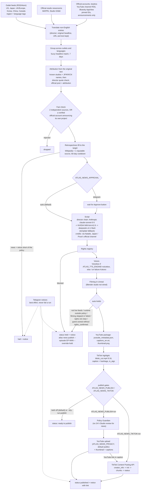

# Clearly Drawn News pipeline

`atlas news produce` builds one episode end to end. `atlas daemon start --news-only` runs it at each
`ATLAS_NEWS_HOURS` slot (default `12` = one episode a day at 12:00, PC local time, MDT).
Episodes target 30 minutes (`ATLAS_NEWS_TARGET_MINUTES`): verified news first, then animation-history
retrospectives fill the rest. Nothing uploads unless `ATLAS_NEWS_PUBLISH=on` (YouTube) or `ATLAS_NEWS_TIKTOK=on` (TikTok); both are off by default.



## Sources

Outlet feeds live in `crates/atlas-media/src/news_wire.rs` (`FEEDS`), each with a region tag and a language.
General-news feeds (Yonhap, Soompi, The Korea Herald, Sixth Tone, Playback) only contribute animation stories.
Every feed path is allowed by the site's robots.txt; requests use an identifiable User-Agent.

| Region | Working (checked 2026-10-18) | Blocked or no feed |
| --- | --- | --- |
| US / global | Anime News Network, Cartoon Brew, Animation Magazine, Crunchyroll News, AWN, Variety, THR, Deadline, IndieWire, The Animation Guild | |
| Japan | Anime Corner (English), MAPPA newsroom (ja), Studio Ghibli newsroom (ja); official YouTube: Toei Animation, MAPPA, Aniplex (JP + USA), TOHO Animation, Kadokawa | Natalie (405 to non-browser clients), Animate Times (no feed), MANTANWEB (empty feed / 403), Oricon (410 Gone), Famitsu (no feed), Toho / Toei / Aniplex / Kadokawa newsrooms (no RSS; their YouTube channels are followed) |
| Europe | Skwigly (UK), Animation Magazine Europe; Cartoon Saloon (official YouTube) | Annecy (no feed), AWN Europe (403), Cartoon Brew Europe tag (empty) |
| Korea | Yonhap culture, Soompi, The Korea Herald (animation stories only) | |
| China | Sixth Tone (animation stories only) | SCMP (404) |
| Canada / LatAm | Playback (Canada), Animation Magazine | no reputable Latin American animation feed found yet |

Non-English entries are translated by the director before grouping (`news_translate.rs`, cache in
`news/translations.json`). The original headline and summary stay on the entry and the article text is never
translated, so attribution, rumour checks and the quoted evidence use the original. An entry that cannot be
translated (no director) is dropped, never aired untranslated. A translation only makes a story groupable with
other coverage; it still needs a real second source.

### Official accounts

`crates/atlas-media/data/official_accounts.json` (override with `ATLAS_NEWS_ACCOUNTS=<file>`) pins each account
by platform ID (YouTube channel ID, Bluesky DID) with how it was verified (verified badge, domain handle, or a
link from the studio's own website). A fetch fails if the platform reports another channel or handle for that ID.
`atlas news accounts-check` re-verifies them all (read-only, no keys).

- YouTube channel RSS (no key): Adult Swim, Pixar, Walt Disney Animation Studios, Cartoon Network, Nickelodeon,
  Netflix Anime, Sony Pictures Animation, Illumination, LAIKA, Cartoon Saloon, Crunchyroll, Toei Animation,
  MAPPA, Aniplex, Aniplex USA, TOHO Animation, Kadokawa. Only announcements (trailer, teaser, PV, release date,
  予告, 解禁, 決定, ...) become stories.
- Bluesky public AppView (no key): Netflix (`netflix.com`), Crunchyroll (`crunchyroll.com`), both
  Bluesky-verified. The other studios have no verified Bluesky account yet.
- Not followed: DreamWorks Animation (no verifiable main channel), Studio Ghibli YouTube (none; its newsroom
  feed is used), a dedicated Netflix Animation channel (none). X is not used at all. Instagram, TikTok and
  Threads need logins or app tokens and are not used. No logged-in page is ever scraped.

### The two-source rule

`NEWS_MIN_SOURCES` is 2 and not configurable. `fact_checker::qualifies_as_official_primary` makes the exception explicit:

- Two independent sources always qualify: two outlets, or an official account plus one independent outlet.
  An organisation's own channels and newsroom count as one source between them; sources can be in different languages.
- One source qualifies only as a primary source: a pinned, verified official account or newsroom of the
  attributed organisation announcing its own project. It is credited on air as such ("Pixar announced it on its
  official YouTube channel").
- Anything else with one source fails, and official status never rescues a rumour or an unattributed story.

On air and in the description each source is credited with its region ("via Natalie, Japan"); stories carry a
region tag, so an episode mixes regions. Official trailers are linked from the description, never re-uploaded.

### Director chain

`DirectorClient` tries Anthropic first (Eli's Claude credits, `ANTHROPIC_API_KEY`), then NVIDIA NIM's free
models at `integrate.api.nvidia.com/v1` with `NVIDIA_API_KEY`: `moonshotai/kimi-k2.6` (scripts and translation),
then `deepseek-ai/deepseek-v4.1-flash`. Billing, quota, credit or key errors (402, 401, 403, or 400/429 that
mention credits or quota) take a provider out for the rest of the run; rate limits, overload, 5xx and timeouts
fail over for that call only. Quirks: Claude gets no `temperature` or `response_format` and `max_tokens` 8192;
NIM gets `max_tokens` 8192, temperature clamped to 0..1 (Kimi K2 pinned at 0.6), no JSON mode for Kimi,
DeepSeek or reasoning models, and `<think>` blocks are stripped. Every call logs
`[director] <purpose>: <provider>:<model> <outcome> (<ms>)` to stderr and, with `ATLAS_DIRECTOR_LOG=<file>`,
one JSON line per call. `atlas news director-check` shows the chain and which keys exist (never their values).

## Settings

| Setting | Default | Meaning |
| --- | --- | --- |
| `ATLAS_NEWS_PUBLISH` | `off` | `on` uploads; anything else stops at the package (dry run) |
| `ATLAS_NEWS_PRIVACY` | `public` | `public`, `unlisted` or `private` |
| `ATLAS_NEWS_APPROVAL` | `auto` | `telegram` waits for the Approve button |
| `ATLAS_NEWS_HOURS` | `12` | daemon slots in local time (comma-separated); `off` disables |
| `ATLAS_NEWS_TARGET_MINUTES` | `30` | runtime target (10 to 60); retrospectives fill to it |
| `ATLAS_NEWS_MIN_MINUTES` / `ATLAS_NEWS_MAX_MINUTES` | target -5 / +5 | runtime policy; outside it the episode is held |
| `ATLAS_NEWS_ACCOUNTS` | built-in list | JSON file of official accounts to follow |
| `ANTHROPIC_API_KEY` | set | primary director (Claude credits) |
| `NVIDIA_API_KEY` | unset | NVIDIA NIM fallback once Claude credits or quota run out |
| `ATLAS_DIRECTOR_FALLBACK_MODELS` | `moonshotai/kimi-k2.6,deepseek-ai/deepseek-v4.1-flash` | NIM fallback order |
| `ATLAS_DIRECTOR_FALLBACK` | on | `off` disables the NIM fallback |
| `ATLAS_DIRECTOR_URL` / `_MODEL` / `_API_KEY` | Anthropic, `claude-sonnet-5-5` | primary provider override |
| `ATLAS_DIRECTOR_TIMEOUT_SECS` | `180` (60 for a NIM-only chain) | request timeout |
| `ATLAS_DIRECTOR_LOG` | unset | JSONL file with one line per director call |
| `ATLAS_TTS_ENGINE` | `kokoro` | `voicebox` to opt in (falls back to Kokoro) |
| `ATLAS_CASTING_CSV` | `AtlasStudioOffice/casting/CDN_Interview_Bookings_Month1.csv` | guest bookings; add a `rights_confirmed` column (`yes`) to clear a trademark caveat |
| `ATLAS_NEWS_TIKTOK` | `off` | `on` posts the TikTok highlight |
| `ATLAS_TIKTOK_PRIVACY` | `PUBLIC_TO_EVERYONE` | must be offered by the account; unaudited apps only get `SELF_ONLY` |
| `ATLAS_TIKTOK_MAX_SECS` | `180` | highlight cap (every creator can post 3 minutes; the API allows up to 600) |
| `ATLAS_TIKTOK_FRAMING` | `pad` | `pad` = 16:9 frame over a blurred 9:16 fill (both anchors visible); `crop` = centre crop |
| `TIKTOK_CLIENT_KEY` / `TIKTOK_CLIENT_SECRET` | unset | TikTok developer app keys (User env vars, never in the repo) |
| `TIKTOK_REDIRECT_URI` | `http://localhost:3455/callback/` | must be registered in the app's Login Kit settings |
| `ATLAS_TIKTOK_TOKEN` | `tiktok_token.json` in the working dir | OAuth token (refreshed automatically) |
| `TELEGRAM_BOT_TOKEN` / `TELEGRAM_CHAT_ID` | unset | notices; a bad or missing token is ignored |
| `ATLAS_YOUTUBE_CREDENTIALS` | `youtube_credentials.json` in the working dir or `Marker\` | OAuth client; token is `youtube_token.json` in the working dir |

## YouTube package

- Title `Clearly Drawn News <episode title>` (100 characters max), category 1 (Film & Animation: the show is
  an animated program, and News & Politics would invite news-publisher scrutiny for an entertainment-industry show).
- Description: per story the source links, region tag, original headline (translated stories), official
  announcement line and "Via" credits; the AI and synthetic-media disclosure; a sourcing line that only claims
  two sources (or a studio's own announcement) when every story has one.
- Captions `captions_en.srt` from the voice timeline (84 characters per cue, 42 per line).
- Thumbnail: `blender/story_cards.py card` brand card (plain Python, no Blender), scaled to a 1280x720 PNG of 2 MB or less.

## TikTok

The highlight is the top of the show (cold open into the first story), cut on whole voiced lines so it
never stops mid-sentence, up to `ATLAS_TIKTOK_MAX_SECS`. The caption is the lead headline, the episode
number, the YouTube link (filled in after the YouTube upload), an AI-anchor disclosure, the source
outlets and the hashtags `#ClearlyDrawnNews #animation #animationnews #cartoon #anime #animationindustry`
(2200 UTF-16 units max). The post sets `is_aigc: true`, never marks brand content, and takes the
account's own comment/duet/stitch settings. Before posting it reads `creator_info` and refuses a privacy
level the account does not offer or a cut longer than the account may post.

Setup, once:

1. Create an app at developers.tiktok.com, add **Login Kit** (Desktop) and **Content Posting API** with
   **Direct Post**, scopes `user.info.basic` and `video.publish`, and register the redirect URI
   `http://localhost:3455/callback/`.
2. Put the Client key and Client secret in User env vars `TIKTOK_CLIENT_KEY` and `TIKTOK_CLIENT_SECRET`.
3. From `Marker\`: `atlas news tiktok-auth`, open the URL, approve, copy the URL the browser lands on
   (the page itself will not load; that is fine) and run `atlas news tiktok-auth-complete --redirect "<URL>"`.
4. `atlas news tiktok-check` (read-only).
5. Until TikTok audits the app, posts can only be private: set `ATLAS_TIKTOK_PRIVACY=SELF_ONLY` to test,
   then submit the app for audit to post publicly.

## Commands

```text
atlas news produce --dry-run-publish                 # full run, stops before upload
atlas news publish --episode EP-004 --dry-run        # rebuild the package only
atlas news publish --episode EP-004 [--override-hold]
atlas news youtube-check                             # read-only token + channel check
atlas news accounts-check                            # re-verify followed official accounts (no keys)
atlas news director-check                            # director failover chain + which keys exist
atlas news tiktok-check                              # read-only TikTok account check
atlas daemon start --news-only                       # scheduled slots, no explainer publishing
```

## Scheduling

`scripts/cdn-news-daemon.cmd` starts `target\release\atlas.exe daemon start --news-only` from `Marker\` and
appends to `%LOCALAPPDATA%\atlas-studio\atlas\data\daemon\daemon.log`. The Task Scheduler task
`CDN News Daemon` runs it at logon and is registered **disabled**. To go live:

```powershell
[Environment]::SetEnvironmentVariable('ATLAS_NEWS_PUBLISH','on','User')
[Environment]::SetEnvironmentVariable('ATLAS_NEWS_TIKTOK','on','User')    # optional, after TikTok setup
Enable-ScheduledTask -TaskName 'CDN News Daemon'
Start-ScheduledTask -TaskName 'CDN News Daemon'   # or log off and on
```
