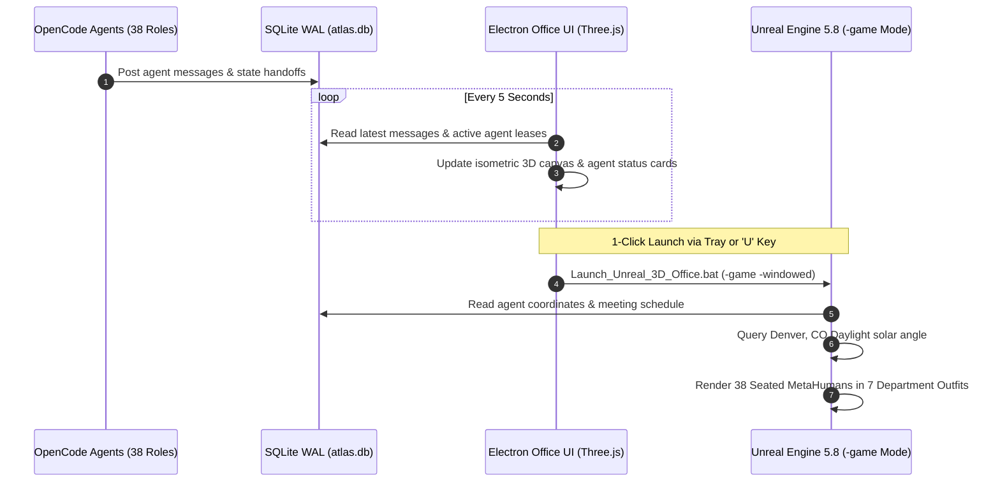
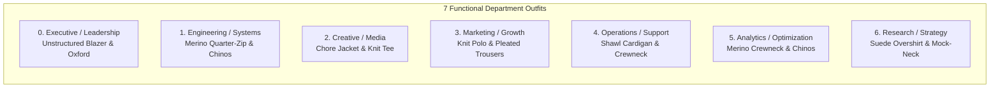

# Clearly Drawn Studios HQ — 3D Office & MetaHuman Simulation

> **Legacy.** The office simulation is no longer part of the production pipeline. Don't extend it or add
> dependencies on it, and don't delete it without asking. The Blender broadcast studio is documented in
> `docs/BLENDER_STUDIO.md` and `AtlasStudioOffice\PIPELINE_STUDIO_README.md`.


## Overview

The Clearly Drawn Studios 3D Virtual Spectator simulation provides a real-time, 24/7 digital twin of the 38 autonomous agents collaborating inside Clearly Drawn Studios. Built on Unreal Engine 5.8 with DirectX 12 SM6, Lumen dynamic global illumination, and native MetaHuman characters, the simulation renders an immersive isometric studio office synchronized directly with the local SQLite WAL message bus and agent state.

---

## Architecture Diagram



---

## 38 Workstations & Layout

The studio office is laid out in a 10-column modular grid with 7.5-meter X spacing and 6.0-meter Y spacing:
- **Workstations (Row 0 - Row 3)**: 38 desks equipped with real metal office desks, modern armchairs, desktop PC workstations, articulated desk lamps, stationery supplies, and Fab Marketplace document binders or laptops.
- **38-Seat Boardroom**: Located north of the workstations (`Y = +2000.0`), featuring dual Fab Marketplace [`meet_Desk`](file:///c:/Users/chrom/Desktop/Marker/AtlasStudioOffice/Content/Assets/Props/FabOfficeWork/meet_Desk.uasset) tables, 38 conference chairs, and a presentation [`projector_screen`](file:///c:/Users/chrom/Desktop/Marker/AtlasStudioOffice/Content/Assets/Props/ProjectorScreen/projector_screen_1k/StaticMeshes/projector_screen.uasset).
- **Kitchenette & Break Room**: Located east (`X = +4200.0`), featuring a Poly Haven CC0 espresso cart, ceramic mugs, pitcher, real vending machine, and two modern lounge sofas.
- **Operations & Brainstorming Hub**: Central operations equipped with Fab Marketplace office printers, filing storage cabinets, and whiteboard bullpen.

---

## 7 Distinct Outfit Styles

To distinguish agent departments visually, 7 distinct outfits are assigned across the 38 workstations:



All looks follow the elevated smart casual dress code in [`unreal/wardrobe.json`](../unreal/wardrobe.json) (no ties, suits, hoodies, or athleisure), applied by `unreal/Content/Python/clearly_drawn_wardrobe.py`. Every agent uses native MetaHuman components (`SKM_Body`, `SKM_Face`, `MH_Groom_Head`, and the department's outfit mesh) attached to `BP_CrowdActor`, seated facing their workstation monitor.

---

## Zero-Primitives Guarantee

```
Primitive Shape Actors Found: 0
Verification Status: 100% Real Copyright-Free 3D Models
```

All placeholder geometry (cubes, cylinders, spheres) has been eliminated:
1. Floor: Fab Marketplace [`Base`](file:///c:/Users/chrom/Desktop/Marker/AtlasStudioOffice/Content/Assets/Props/FabOfficeWork/Base.uasset) modular architectural floor mesh.
2. Tables: Fab Marketplace conference desks.
3. Kitchenette: Real coffee cart, mugs, pitcher, vending machine.
4. Clutter & Storytelling: Fab Marketplace binders, filing storage, printers, cardboard supply boxes, and laptops. Zero Sketchfab assets.

---

## Launch Instructions

```cmd
# Option 1: Double-click desktop batch script
C:\Users\chrom\Desktop\Marker\Launch_Unreal_3D_Office.bat

# Option 2: Electron UI hotkey
Press 'U' or click "⚡ Virtual Spectator (UE 5.8)" in the Electron visualizer
```
